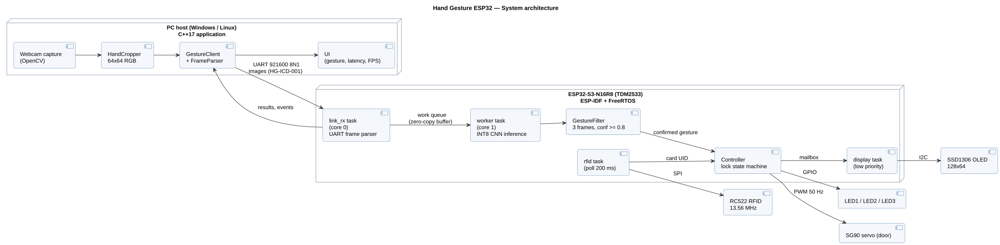

# Hand Gesture ESP32


Control lights and a door with hand gestures. An **INT8-quantized CNN** runs on an **ESP32-S3**
with an inference engine written in plain C. A C++ application on the PC captures the webcam,
crops the hand and streams it over **UART**; the ESP32-S3 drives an **I2C OLED**, an **SPI RFID reader**,
LEDs and a servo under **FreeRTOS**.

> **Status:** Phase 2 of 6 — the model runs bit-exact in the C engine and the firmware is built by CI.
> Hardware bring-up and on-device measurements are next. See the [roadmap](#roadmap).

<!-- Demo video / GIF: add after Phase 5 -->

## How it works



1. The **PC application** (C++17, OpenCV) captures a webcam frame, finds the hand and resizes it to 64×64 RGB.
2. The image is sent to the ESP32-S3 in a binary frame with a **CRC-16** over UART at 921 600 baud ([protocol](docs/protocol.md)).
3. On the ESP32-S3, one FreeRTOS task receives frames while another runs the **INT8 CNN** (18 classes).
4. A **gesture filter** accepts a gesture only after 3 consecutive matching predictions with confidence ≥ 0.8.
5. A **state machine** executes the action only when the system was unlocked with a registered **RFID card**.

| Gesture | Action | | Gesture | Action |
|---|---|---|---|---|
| `palm` | All lights on | | `like` | Open door |
| `fist` | All lights off | | `dislike` | Close door |
| `one` / `rock` / `mute` | Toggle light 1 / 2 / 3 | | `stop` | Lock the system |

Gestures were selected from the model's per-class test results so that the most likely mistake maps to *no action*
([requirements §5.1](docs/requirements.md#51-gesture-recognition-ges)).

## Model

| | FP32 | INT8 (deployed) |
|---|---|---|
| Classes | 18 (HaGRID) | 18 |
| Input | 64×64 RGB | 64×64 RGB |
| Test accuracy (5 032 images, split by user) | 94.6 % | 94.2 % (QAT W8A8) |
| Weights | 370 KB | **92.6 KB** |
| MACs per image | 16.1 M | 16.1 M |
| Peak activation memory | 256 KB | **64 KB** |

Quantization: symmetric INT8, per-channel weights, BatchNorm folded, no zero-point.
The C engine uses integer arithmetic only (fixed-point requantization) and produces **bit-exact** logits
compared with a NumPy reference model.

## Results

| Metric | Value |
|---|---|
| Bit-exact logits vs. reference model (host, 10 test images) | 10 / 10 ✅ |
| On-device inference time @ 240 MHz | _to be measured (Phase 2)_ |
| Per-image round trip PC → ESP32 → PC | _to be measured (Phase 5)_ |
| Gesture-to-action latency | _to be measured (Phase 5)_ |

## Hardware

| Part | Interface | ESP32-S3 pins |
|---|---|---|
| ESP32-S3-N16R8 dev board (TDMaker TDM2533) | — | — |
| PC link (on-board USB-UART bridge) | UART0, 921 600 baud | TX 43, RX 44 |
| SSD1306 0.96" OLED | I2C, 400 kHz | SDA 8, SCL 9 |
| RC522 RFID reader | SPI | SCK 12, MOSI 11, MISO 13, CS 10, RST 14 |
| 3 LEDs (220 Ω) | GPIO | 4, 5, 6 |
| SG90 servo | PWM 50 Hz (LEDC) | 7 |

## Repository layout

```
.github/workflows/  CI: host test + ESP-IDF firmware build on every push
docs/               requirements, UART protocol, UML diagrams (PlantUML sources + SVG)
firmware/           ESP-IDF project for the ESP32-S3 (C)
host/               Linux build of the inference engine + bit-exact test
model/              INT8 export script (PyTorch checkpoint -> C arrays)
pc_app/             C++ host application (Phase 3)
tests/              end-to-end tests (Phase 5)
```

## Build and run

**Host test (Linux / WSL)** — checks that the C engine matches the reference model:

```bash
make -C host
```

**Firmware** — built automatically by GitHub Actions on every push:

1. Open the **Actions** tab, pick the latest successful run, download the `firmware-esp32s3` artifact.
2. Open [esptool-js](https://espressif.github.io/esptool-js/) in Chrome or Edge, connect to the board's UART port at 921 600 baud.
3. Flash `hand_gesture_merged.bin` at address `0x0`, then open the console at 115 200 baud and press RESET.

## Documentation

| Document | Content |
|---|---|
| [Requirements (HG-SRS-001)](docs/requirements.md) | Functional and non-functional requirements, latency budget, traceability |
| [UART protocol (HG-ICD-001)](docs/protocol.md) | Frame format, CRC, message types, payload layouts, example frames |
| [UML diagrams](docs/uml/) | Use case, architecture, sequence, state machines |

## Roadmap

- [x] Phase 0 — Environment, repository, CI
- [x] Phase 1 — Requirements, protocol specification, UML design
- [ ] Phase 2 — INT8 model on the ESP32-S3, on-device measurements *(firmware built, flashing pending)*
- [ ] Phase 3 — C++ PC application (OOP, design patterns, unit tests)
- [ ] Phase 4 — Firmware: UART link, gesture filter, state machine, OLED (I2C), RFID (SPI), LEDs, servo
- [ ] Phase 5 — Integration and system testing (latency, fault injection, soak test, logic analyzer captures)
- [ ] Phase 6 — Demo video and final documentation

## Author

Tran Yen Quynh — Electronics and Communications Engineering Technology, HCMUTE
