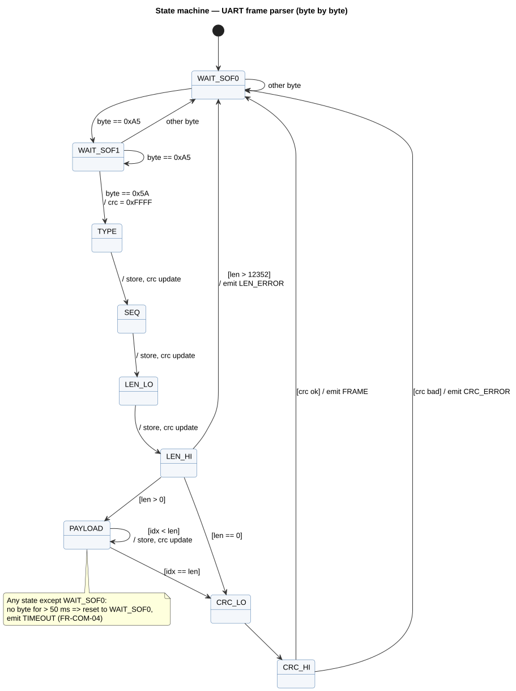

# UART Protocol Specification (Interface Control Document)

| Item | Value |
|---|---|
| Document ID | HG-ICD-001 |
| Protocol version | 2 |
| Document version | 0.1 (draft) |
| Author | Tran Yen Quynh |
| Related | [HG-SRS-001 Requirements](requirements.md) — FR-COM-01 … FR-COM-06 |

## Revision history

| Version | Date | Change |
|---|---|---|
| 0.1 | 2026-11-08 | First draft. Protocol v2 = v1 (PING/INFER/SELFTEST/STATS/PROFILE) + GET_STATE, SET_OUTPUT, EVT_STATE_CHANGED |

---

## 1. Overview

The PC (host) and the ESP32-S3 (device) exchange binary **frames** over a UART link.
Most traffic is **request → response**: the host sends a command, the device answers with the same sequence number.
The device may also send **events** on its own (for example when an RFID card unlocks the system).

```
 Host (PC)                                   Device (ESP32-S3)
    |  ---- request  (type = CMD, seq = n) ---->  |
    |  <--- response (type = CMD | 0x80, seq = n) |   or ERROR (0x7F, seq = n)
    |  <--- event    (type = 0x4x, seq = device counter)   (unsolicited)
```

## 2. Physical layer

| Parameter | Value |
|---|---|
| Interface | UART0 of the ESP32-S3 (GPIO43 TX, GPIO44 RX) via the on-board USB-UART bridge |
| Baud rate | 921 600 |
| Format | 8 data bits, no parity, 1 stop bit (8N1) |
| Flow control | None |
| Logic level | 3.3 V |

Console logs of the firmware are **not** sent on this UART (they go to the native USB-Serial-JTAG port), so log text can never corrupt a frame.

## 3. Frame format

All multi-byte fields are **little-endian**.

| Offset | Size | Field | Description |
|---|---|---|---|
| 0 | 1 | SOF0 | Start of frame, always `0xA5` |
| 1 | 1 | SOF1 | Start of frame, always `0x5A` |
| 2 | 1 | TYPE | Command, response, event or error code (§5) |
| 3 | 1 | SEQ | Sequence number. Host increments it for each request (1…255, wraps); responses echo it |
| 4 | 2 | LEN | Payload length in bytes, 0 … 12 352 |
| 6 | LEN | PAYLOAD | Depends on TYPE |
| 6+LEN | 2 | CRC | CRC-16 over TYPE, SEQ, LEN and PAYLOAD (not over SOF) |

Total frame size = LEN + 8 bytes. Maximum payload = 12 352 bytes (one 12 288-byte image + 64 bytes margin).

### 3.1 CRC

| Parameter | Value |
|---|---|
| Algorithm | CRC-16/CCITT-FALSE |
| Polynomial | `0x1021` |
| Initial value | `0xFFFF` |
| Reflect in / out | No / No |
| Final XOR | `0x0000` |
| Check value (`"123456789"`) | `0x29B1` |

The check value can be verified with any online calculator (for example crccalc.com) and is verified in the unit test `host/test_proto.c`.

### 3.2 Why a start-of-frame and a CRC?

- **SOF (`A5 5A`)**: UART is just a stream of bytes. After a reset, noise or a lost byte, the receiver needs a pattern to find where the next frame begins (resynchronisation, FR-COM-03).
- **LEN**: tells the receiver how many bytes to read, so the payload may contain any value, including `A5 5A`.
- **CRC**: detects corrupted bytes. CRC-16 detects all single- and double-bit errors and all burst errors up to 16 bits.

## 4. Receiver behaviour

The receiver is a byte-by-byte state machine, used in the firmware (`proto.c`) and in the PC application (`FrameParser`).



| Situation | Device behaviour | Host behaviour |
|---|---|---|
| Valid frame | Process it | Match SEQ with the pending request |
| CRC mismatch | Drop frame, send `ERROR(CRC)` | Drop frame, retry request |
| LEN > 12 352 | Drop frame, send `ERROR(LEN)`, resync | Drop frame |
| > 50 ms gap inside a frame | Drop frame, send `ERROR(TIMEOUT)` | — |
| Unknown TYPE | Send `ERROR(UNKNOWN_CMD)` | Ignore |
| Device still busy (both RX buffers full) | Send `ERROR(BUSY)` | Wait 50 ms, retry |
| No response within 1000 ms | — | Retry up to 2 times, then report link error |

## 5. Message types

| TYPE | Name | Direction | Payload | Response |
|---|---|---|---|---|
| `0x01` | PING | Host → Device | none | `0x81` `rsp_ping_t` |
| `0x02` | INFER | Host → Device | 12 288 bytes, RGB888, 64×64, row-major (HWC) | `0x82` `rsp_infer_t` |
| `0x03` | SELFTEST | Host → Device | none | `0x83` `rsp_selftest_t` |
| `0x04` | STATS | Host → Device | none | `0x84` `rsp_stats_t` |
| `0x05` | PROFILE | Host → Device | none | `0x85` array of `rsp_profile_entry_t` |
| `0x06` | GET_STATE | Host → Device | none | `0x86` `sys_state_t` |
| `0x07` | SET_OUTPUT | Host → Device | `req_set_output_t` | `0x87` `sys_state_t` |
| `0x41` | EVT_STATE_CHANGED | Device → Host | `evt_state_changed_t` | none (host must not reply) |
| `0x7F` | ERROR | Device → Host | `rsp_error_t` | none |

Responses use `TYPE = request TYPE | 0x80`. Events use `0x40 … 0x4F` and carry the device's own counter in SEQ.

### 5.1 Payload structures

All structures are packed (no padding). Sizes are in bytes.

**`rsp_ping_t` — 76 bytes**

| Offset | Type | Field | Description |
|---|---|---|---|
| 0 | u8 | proto_version | `2` |
| 1 | u8 | n_classes | `18` |
| 2 | u16 | in_w | `64` |
| 4 | u16 | in_h | `64` |
| 6 | u8 | in_c | `3` |
| 7 | u8 | n_layers | `9` |
| 8 | u32 | model_hash | CRC32 of all model parameters — identifies the model build |
| 12 | u32 | macs | Multiply-accumulate operations per image |
| 16 | u32 | cpu_mhz | CPU clock |
| 20 | char[8] | backend | e.g. `"ref-c"`, zero-terminated |
| 28 | char[32] | model_name | zero-terminated |
| 60 | char[16] | fw_version | e.g. `"1.0.0"` |

**`rsp_infer_t` — 16 + 4 × n_classes bytes (88 bytes for 18 classes)**

| Offset | Type | Field | Description |
|---|---|---|---|
| 0 | u8 | class_id | Predicted class (0 … 17) |
| 1 | u8 | n_classes | Number of logits that follow |
| 2 | u16 | conf_permille | Softmax confidence × 1000 |
| 4 | u32 | infer_us | Engine time (LUT + network), µs |
| 8 | u32 | device_us | Time from last byte received to response queued, µs |
| 12 | u8 | action | Action executed by this image (`action_t`, 0 = none) |
| 13 | u8 | filter_count | Consecutive images with the same class (gesture filter) |
| 14 | u8 | lock_state | `lock_state_t` after this image |
| 15 | u8 | outputs | Bit 0–2 = LED1–LED3, bit 3 = door open |
| 16 | i32[n] | logits | Raw INT8-model logits (bit-exact with the reference model) |

**`rsp_selftest_t` — 16 bytes**

| Offset | Type | Field |
|---|---|---|
| 0 | u8 | passed |
| 1 | u8 | total |
| 2 | u16 | reserved |
| 4 | u32 | avg_us |
| 8 | u32 | min_us |
| 12 | u32 | max_us |

**`rsp_stats_t` — 44 bytes**

| Offset | Type | Field |
|---|---|---|
| 0 | u32 | uptime_ms |
| 4 | u32 | n_frames_ok |
| 8 | u32 | n_infer |
| 12 | u32 | n_crc_err |
| 16 | u32 | n_len_err |
| 20 | u32 | n_timeout |
| 24 | u32 | heap_internal_free |
| 28 | u32 | heap_internal_min |
| 32 | u32 | psram_free |
| 36 | u32 | last_infer_us |
| 40 | u8 | post_passed |
| 41 | u8 | post_total |
| 42 | u16 | reserved |

**`rsp_profile_entry_t` — 16 bytes each (9 entries)**

| Offset | Type | Field |
|---|---|---|
| 0 | char[12] | layer name |
| 12 | u32 | time of the last inference, µs |

**`sys_state_t` — 6 bytes**

| Offset | Type | Field | Description |
|---|---|---|---|
| 0 | u8 | lock_state | `lock_state_t` |
| 1 | u8 | outputs | Bit 0–2 = LED1–LED3, bit 3 = door open |
| 2 | u8 | last_gesture | Last confirmed class, `0xFF` = none |
| 3 | u8 | denied_count | Consecutive denied cards |
| 4 | u16 | unlock_remaining_s | Seconds until auto-lock (0 when LOCKED) |

**`req_set_output_t` — 2 bytes** (manual control for testing, FR-ACT)

| Offset | Type | Field | Values |
|---|---|---|---|
| 0 | u8 | target | 1 = LED1, 2 = LED2, 3 = LED3, 4 = door |
| 1 | u8 | value | 0 = off/closed, 1 = on/open |

Rejected with `ERROR(LOCKED)` when the system is LOCKED.

**`evt_state_changed_t` — 7 bytes**

| Offset | Type | Field |
|---|---|---|
| 0 | `sys_state_t` | state after the change |
| 6 | u8 | reason (`reason_t`) |

**`rsp_error_t` — 2 bytes**

| Offset | Type | Field |
|---|---|---|
| 0 | u8 | code (`error_t`) |
| 1 | u8 | req_type — TYPE of the request that failed (0 if unknown) |

### 5.2 Enumerations

| `lock_state_t` | Value |
|---|---|
| LOCKED | 0 |
| UNLOCKED | 1 |
| LOCKOUT | 2 |

| `action_t` | Value | | `reason_t` | Value |
|---|---|---|---|---|
| NONE | 0 | | RFID_OK | 1 |
| LED1_TOGGLE | 1 | | RFID_DENIED | 2 |
| LED2_TOGGLE | 2 | | GESTURE | 3 |
| LED3_TOGGLE | 3 | | AUTO_LOCK_TIMEOUT | 4 |
| ALL_ON | 4 | | HOST_COMMAND | 5 |
| ALL_OFF | 5 | | LOCKOUT_END | 6 |
| DOOR_OPEN | 6 | | | |
| DOOR_CLOSE | 7 | | | |
| LOCK | 8 | | | |

| `error_t` | Value | Meaning |
|---|---|---|
| CRC | 1 | CRC mismatch |
| LEN | 2 | Length too large or wrong for this TYPE |
| UNKNOWN_CMD | 3 | TYPE not supported |
| BUSY | 4 | No free receive buffer |
| TIMEOUT | 5 | Inter-byte gap > 50 ms |
| INTERNAL | 6 | Firmware error |
| LOCKED | 7 | Command not allowed while LOCKED |

## 6. Example frames

These byte sequences can be used to test a parser by hand (for example by sending them from a serial terminal in hex mode).

| Description | Bytes (hex) |
|---|---|
| PING, seq 1 | `A5 5A 01 01 00 00 44 C5` |
| GET_STATE, seq 2 | `A5 5A 06 02 00 00 39 CD` |
| SET_OUTPUT LED2 ON, seq 3 | `A5 5A 07 03 02 00 02 01 A8 B3` |
| ERROR(CRC) answering request type 0x01, seq 7 | `A5 5A 7F 07 02 00 01 01 23 27` |

Breakdown of the PING frame:

```
A5 5A   start of frame
01      TYPE = PING
01      SEQ  = 1
00 00   LEN  = 0 (little-endian)
44 C5   CRC  = 0xC544, computed over "01 01 00 00", sent low byte first
```

## 7. Timing

| Item | Value |
|---|---|
| One INFER request on the wire | 12 296 bytes ≈ **134 ms** at 921 600 baud |
| One INFER response | 96 bytes ≈ 1 ms |
| Device inter-byte timeout | 50 ms |
| Host response timeout | 1000 ms |
| Device receive buffers | 2 × 12 352 bytes (image N+1 is received while image N is inferred) |

## 8. Versioning rules

- `proto_version` is reported in PING. The host must read it first and refuse to continue if the major version differs.
- New message types and new fields **at the end** of a payload are allowed without changing the version.
- Changing the meaning, size or order of an existing field requires a new `proto_version`.
