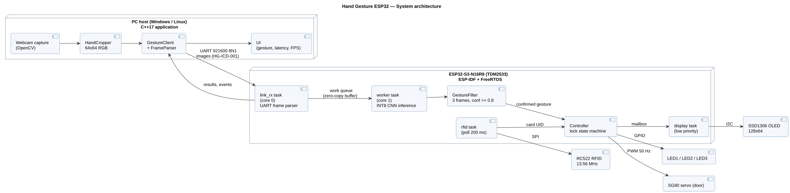
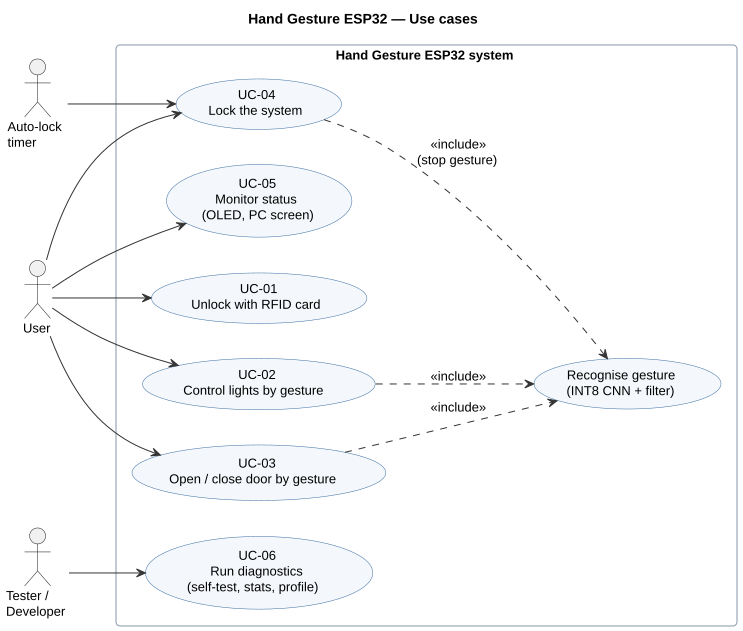

# System Requirements Specification — Hand Gesture ESP32

| Item | Value |
|---|---|
| Document ID | HG-SRS-001 |
| Version | 0.1 (draft) |
| Author | Tran Yen Quynh |
| Status | Draft — under review |
| Related documents | [HG-ICD-001 UART Protocol](protocol.md), [UML diagrams](uml/) |

## Revision history

| Version | Date | Author | Change |
|---|---|---|---|
| 0.1 | 2026-11-08 | Tran Yen Quynh | First draft |

---

## 1. Purpose and scope

This document defines **what** the Hand Gesture ESP32 system must do and **how each requirement will be verified**.
It does not describe how the system is implemented; design details are in the protocol specification and the UML diagrams.

The system lets a user control simple home devices (3 lights and a door) with hand gestures.
A PC captures webcam images, crops the hand and sends it over UART to an ESP32-S3.
The ESP32-S3 runs an INT8 CNN, decides which action to take and drives the outputs.
An RFID card is required to unlock the system before gestures are accepted.

**In scope:** PC host application, ESP32-S3 firmware, UART protocol, I2C display, SPI RFID reader, GPIO/PWM outputs, tests.
**Out of scope:** model training (done on Kaggle, see `model/`), cloud connectivity, mains-voltage loads.

## 2. Definitions

| Term | Meaning |
|---|---|
| Frame (image) | One 64×64 RGB888 hand crop = 12 288 bytes |
| Frame (protocol) | One packet on the UART link, see HG-ICD-001 |
| Gesture class | One of the 18 HaGRID classes output by the model |
| Confirmed gesture | Same class predicted in N consecutive images with confidence ≥ threshold (FR-GES-03) |
| LOCKED / UNLOCKED | System states, see [state diagram](uml/state_system.svg) |
| Shall / Should / May | Mandatory / recommended / optional requirement |

## 3. System context

| Block | Hardware / software | Role |
|---|---|---|
| PC host | Windows or Linux laptop, C++17 application (OpenCV) | Webcam capture, hand crop, UI, sends images |
| Controller | ESP32-S3-N16R8 (TDMaker TDM2533), ESP-IDF, FreeRTOS | Inference, gesture filter, system state machine, outputs |
| Display | SSD1306 0.96" 128×64 OLED, I2C | Local status |
| Access control | RC522 13.56 MHz RFID reader, SPI | Unlock with card |
| Lights | 3 LEDs on GPIO | Simulate 3 room lights |
| Door | SG90 servo on PWM | Simulate a door lock |

### 3.1 Pin allocation (ESP32-S3)

| Signal | GPIO | Note |
|---|---|---|
| UART0 TX / RX (PC link) | 43 / 44 | Through the on-board USB-UART bridge ("UART" connector) |
| I2C SDA / SCL (OLED) | 8 / 9 | 400 kHz |
| SPI SCK / MOSI / MISO / CS (RC522) | 12 / 11 / 13 / 10 | SPI2, ≤ 10 MHz |
| RC522 RST | 14 | |
| LED1 / LED2 / LED3 | 4 / 5 / 6 | 220 Ω series resistor each |
| Servo PWM | 7 | LEDC, 50 Hz |
| Reserved — do not use | 19, 20, 26–37 | Native USB, flash, octal PSRAM |

## 4. Use cases

| ID | Use case | Actor | Summary |
|---|---|---|---|
| UC-01 | Unlock with card | User | Tap a registered card to unlock the system |
| UC-02 | Control lights by gesture | User | Turn lights on/off with gestures |
| UC-03 | Open / close door by gesture | User | Move the servo with gestures |
| UC-04 | Lock the system | User, Timer | Lock by gesture or after inactivity |
| UC-05 | Monitor status | User | See state on OLED and on the PC |
| UC-06 | Run diagnostics | Tester | Self-test, statistics, per-layer profile |

## 5. Functional requirements

Priority: **M** = Must, **S** = Should, **C** = Could.
Verification: **T** = Test, **D** = Demonstration, **I** = Inspection, **A** = Analysis.

### 5.1 Gesture recognition (GES)

| ID | Requirement | Prio | Verif. |
|---|---|---|---|
| FR-GES-01 | The ESP32-S3 shall classify a 64×64 RGB888 image into one of 18 gesture classes using the INT8 model. | M | T |
| FR-GES-02 | The on-device logits shall be bit-exact with the NumPy integer reference model for the embedded test images. | M | T |
| FR-GES-03 | The system shall confirm a gesture only when the same class is predicted in **3 consecutive images**, each with confidence **≥ 0.80**. | M | T |
| FR-GES-04 | After a confirmed gesture triggers an action, the system shall ignore new gestures for a **1.5 s cooldown**. | M | T |
| FR-GES-05 | Gesture classes not listed in Table 5.1 shall produce no action. | M | T |

**Table 5.1 — Gesture → action mapping**

Gestures were chosen from the model's test results (`model/report`): high F1-score, and their most frequent confusion is with a class that has **no action**, so a misclassification does nothing instead of triggering the wrong device.

| Gesture | Action | F1 (FP32 test) | Most confused with | Why it is safe |
|---|---|---|---|---|
| `palm` | All lights ON | 0.969 | — | High F1 |
| `fist` | All lights OFF | 0.975 | — | High F1 |
| `one` | Toggle LED1 | 0.939 | `two_up` (3.3 %) | `two_up` has no action |
| `rock` | Toggle LED2 | 0.964 | — | High F1 |
| `mute` | Toggle LED3 | 0.976 | — | High F1 |
| `like` | Open door | 0.941 | `call` (3.4 %) | `call` has no action |
| `dislike` | Close door | 0.990 | — | Highest F1 |
| `stop` | Lock system | 0.929 | `stop_inverted` (3.9 %) | `stop_inverted` has no action |

Rejected on purpose: `peace` (F1 0.901) and `three` (F1 0.914), the two weakest classes, which are also confused with each other.

### 5.2 Access control and system state (SEC)

| ID | Requirement | Prio | Verif. |
|---|---|---|---|
| FR-SEC-01 | The system shall start in the **LOCKED** state after power-on or reset. | M | T |
| FR-SEC-02 | In LOCKED, the system shall ignore all gesture actions. | M | T |
| FR-SEC-03 | When a card whose UID is in the whitelist is read, the system shall enter **UNLOCKED**. | M | T |
| FR-SEC-04 | When an unknown card is read, the system shall stay LOCKED and show "ACCESS DENIED" for 2 s. | M | T |
| FR-SEC-05 | In UNLOCKED, the system shall return to LOCKED on: the `stop` gesture, a registered card tapped again, or **30 s** without a confirmed gesture. | M | T |
| FR-SEC-06 | After **3** consecutive denied cards, the system should refuse all cards for **30 s** (LOCKOUT). | C | T |
| FR-SEC-07 | Entering LOCKED shall not change the lights or the door position. | S | T |

### 5.3 Actuation (ACT)

| ID | Requirement | Prio | Verif. |
|---|---|---|---|
| FR-ACT-01 | The system shall drive LED1–LED3 according to Table 5.1. | M | D |
| FR-ACT-02 | The servo shall move to 0° (closed) and 90° (open) using a 50 Hz PWM signal. | M | T |
| FR-ACT-03 | All outputs shall be OFF / door closed after power-on. | M | T |

### 5.4 Communication (COM)

| ID | Requirement | Prio | Verif. |
|---|---|---|---|
| FR-COM-01 | PC and ESP32-S3 shall communicate over UART at 921 600 baud, 8N1, using the frame format in HG-ICD-001. | M | T |
| FR-COM-02 | Every frame shall be protected by CRC-16/CCITT-FALSE; frames with a wrong CRC shall be discarded and answered with error code `CRC`. | M | T |
| FR-COM-03 | The receiver shall resynchronise on the next start-of-frame after noise or a corrupted frame. | M | T |
| FR-COM-04 | A frame that stops for more than **50 ms** between two bytes shall be discarded and answered with error code `TIMEOUT`. | M | T |
| FR-COM-05 | The ESP32-S3 shall send an `EVT_STATE_CHANGED` frame to the PC whenever the system state, a light or the door changes. | S | T |
| FR-COM-06 | The PC shall time out a request after 1000 ms and retry at most 2 times. | S | T |

### 5.5 Display (DSP)

| ID | Requirement | Prio | Verif. |
|---|---|---|---|
| FR-DSP-01 | The OLED shall show: lock state, last confirmed gesture, state of the 3 lights and the door. | M | D |
| FR-DSP-02 | The OLED refresh shall never delay inference (display runs in its own low-priority task). | M | A |
| FR-DSP-03 | If no OLED answers on I2C at boot, the firmware shall continue without the display and log a warning. | S | T |

### 5.6 Diagnostics (DIAG)

| ID | Requirement | Prio | Verif. |
|---|---|---|---|
| FR-DIAG-01 | At boot, the firmware shall run the embedded golden images (power-on self-test, POST) and log the result. | M | T |
| FR-DIAG-02 | The firmware shall report, on request: POST result, frame/error counters, free heap and last inference time. | M | T |
| FR-DIAG-03 | The firmware should report the inference time of each layer on request. | S | T |

### 5.7 PC host application (PC)

| ID | Requirement | Prio | Verif. |
|---|---|---|---|
| FR-PC-01 | The PC application shall be written in C++17 and build with CMake on Windows and Linux. | M | I |
| FR-PC-02 | The PC application shall crop the hand from the webcam image and resize it to 64×64 RGB. | M | D |
| FR-PC-03 | The PC application shall display the camera image, the hand box, the predicted gesture, confidence, latency and FPS. | M | D |
| FR-PC-04 | The serial port access shall be hidden behind an interface so the OS-specific implementation can be replaced. | M | I |

## 6. Non-functional requirements

| ID | Requirement | Prio | Verif. |
|---|---|---|---|
| NFR-PERF-01 | On-device inference time (LUT + network) shall be ≤ **100 ms** per image at 240 MHz. *(Target — to be confirmed by measurement, see Phase 2.)* | M | T |
| NFR-PERF-02 | Per-image round trip (PC sends image → PC receives result) shall be ≤ **300 ms**. | M | T |
| NFR-PERF-03 | Gesture-to-action latency (user holds a gesture → output changes) shall be ≤ **1.0 s**. | M | T |
| NFR-PERF-04 | The ESP32-S3 shall still be able to receive the next image while inferring the current one. | S | A |
| NFR-MEM-01 | Model weights shall be ≤ 100 KB and stored in flash; activation memory ≤ 64 KB of internal SRAM. | M | A |
| NFR-MEM-02 | The firmware shall not allocate heap memory after initialisation. | S | I |
| NFR-REL-01 | The system shall run 1000 consecutive images without error, reset or loss of free heap. | M | T |
| NFR-REL-02 | The model accuracy on the HaGRID test split shall be ≥ 94 % (INT8). | M | A |
| NFR-MNT-01 | Every push to GitHub shall build the firmware and run the host tests automatically (CI). | M | I |
| NFR-MNT-02 | Firmware is written in C (C11), PC application in C++17; compiler warnings are treated as errors in CI. | S | I |

### 6.1 Latency budget (analysis for NFR-PERF-02 and NFR-PERF-03)

| Step | Estimate | Basis |
|---|---|---|
| Webcam capture | 33 ms | 30 fps camera |
| Hand crop + resize on PC | ≤ 10 ms | OpenCV, 64×64 output |
| UART transfer of one image | **134 ms** | (12 288 + 8) bytes × 10 bits ÷ 921 600 baud |
| Inference on ESP32-S3 | ≤ 100 ms | NFR-PERF-01 (to be measured) |
| Response + action | ≤ 5 ms | 84-byte response, GPIO write |
| **Per image (sum)** | **≤ 282 ms** | Meets NFR-PERF-02 (≤ 300 ms) |
| **Gesture to action** | **≈ 3 × 282 ≈ 850 ms** | 3 confirmations (FR-GES-03); meets NFR-PERF-03 |

The UART transfer is the largest item. If NFR-PERF-02 fails, the first improvement is a higher baud rate (the USB-UART bridge supports up to 2–3 Mbaud).

## 7. Constraints and assumptions

- Hardware: ESP32-S3-N16R8 (16 MB flash, 8 MB octal PSRAM), one USB-UART bridge, 3.3 V logic.
- The webcam image has a plain background and normal indoor lighting (the hand crop is colour-based).
- Only one user stands in front of the camera.
- The model is trained on HaGRID hand crops; accuracy on real webcam images may be lower and will be reported separately.

## 8. Traceability matrix

Every requirement must be covered by at least one test. Test IDs are defined in `docs/test_report.md` (Phase 5).

| Requirement | Design reference | Test ID |
|---|---|---|
| FR-GES-01, FR-GES-02 | Firmware `model.c`, golden model | T-GES-01 (host `make -C host`), T-GES-02 (on-device POST) |
| FR-GES-03, FR-GES-04, FR-GES-05 | [state_gesture_filter](uml/state_gesture_filter.svg) | T-GES-03 … T-GES-05 (unit test of filter) |
| FR-SEC-01 … FR-SEC-07 | [state_system](uml/state_system.svg), [sequence_rfid_unlock](uml/sequence_rfid_unlock.svg) | T-SEC-01 … T-SEC-07 |
| FR-ACT-01 … FR-ACT-03 | Pin table §3.1 | T-ACT-01 … T-ACT-03 |
| FR-COM-01 … FR-COM-06 | HG-ICD-001 | T-COM-01 … T-COM-06 (parser unit tests + HIL) |
| FR-DSP-01 … FR-DSP-03 | [architecture](uml/architecture.svg) | T-DSP-01 … T-DSP-03 |
| FR-DIAG-01 … FR-DIAG-03 | HG-ICD-001 §5 | T-DIAG-01 … T-DIAG-03 |
| FR-PC-01 … FR-PC-04 | Class diagram (Phase 3) | T-PC-01 … T-PC-04 |
| NFR-PERF-01 … 04 | §6.1 | T-PERF-01 … T-PERF-04 |
| NFR-MEM-01, 02 | Firmware memory report | T-MEM-01, T-MEM-02 |
| NFR-REL-01, 02 | — | T-REL-01 (soak), T-REL-02 (Kaggle report) |
| NFR-MNT-01, 02 | `.github/workflows/build.yml` | T-MNT-01 |

## 9. Open issues

| ID | Issue | Owner | Due |
|---|---|---|---|
| OI-01 | Measure real inference time on the board (NFR-PERF-01). | Quynh | Phase 2 – Task 4 |
| OI-02 | Choose hand-crop method on PC (skin colour vs fixed box) and measure accuracy on real webcam images. | Quynh | Phase 3 |
| OI-03 | Register real RFID card UIDs in the whitelist. | Quynh | Phase 4 |
