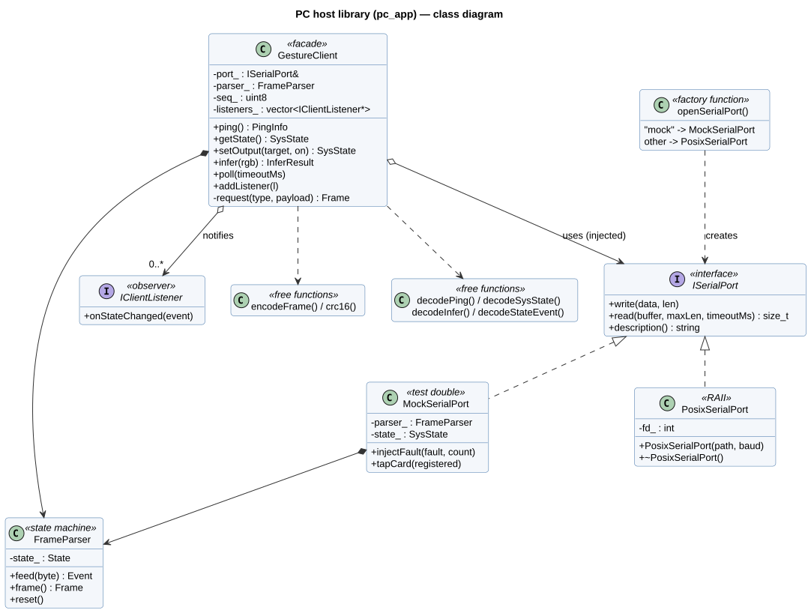

# pc_app — C++ host library

C++17 library and command-line tool that talk to the ESP32-S3 over UART using the protocol in
[docs/protocol.md](../docs/protocol.md). It can be developed and tested without hardware thanks to a
simulated device (`MockSerialPort`).

## Design



| Class | Responsibility | Pattern |
|---|---|---|
| `ISerialPort` | Byte-oriented serial link | Interface (Strategy) |
| `PosixSerialPort` | Real serial port on Linux / macOS (termios) | RAII |
| `MockSerialPort` | Simulated ESP32-S3 with fault injection | Test double |
| `openSerialPort()` | Chooses the implementation from a name | Factory |
| `FrameParser` | Extracts frames from the byte stream, checks CRC | State machine |
| `GestureClient` | Request/response, sequence numbers, timeout, retries | Facade |
| `IClientListener` | Receives events pushed by the device | Observer |

Request handling with timeout and retry: [sequence diagram](../docs/uml/sequence_client_request.svg).

## Build and test (Linux / WSL)

```bash
sudo apt install -y cmake g++ libgtest-dev
cmake -S pc_app -B build/pc_app
cmake --build build/pc_app -j
ctest --test-dir build/pc_app --output-on-failure
```

The build treats warnings as errors and enables AddressSanitizer and UndefinedBehaviorSanitizer by default.

## Command-line tool

```bash
./build/pc_app/hgcli mock ping                 # simulated device
./build/pc_app/hgcli mock set led2 on
./build/pc_app/hgcli /dev/ttyUSB0 state        # real board
./build/pc_app/hgcli /dev/ttyUSB0 infer hand.rgb
```

## Tests

| File | Covers |
|---|---|
| `tests/test_protocol.cpp` | CRC check value, spec example frames, payload decoding, short-payload errors |
| `tests/test_frame_parser.cpp` | Full-size frames, resynchronisation after noise, CRC and length errors, 300 random frames |
| `tests/test_gesture_client.cpp` | Lock rules, events, retries after corrupted or lost responses, timeout, sequence wrap-around |
